# WORLD FRONTIER — 3D Open World

A real, playable 3D open-world game for Android, built as a single self-contained
project: procedural world generation, a third-person character, drivable vehicles,
traffic and pedestrian AI, day/night and weather, missions, and four graphics
presets (LOW default) — running at 60 fps on real hardware and packaged as a
signed APK.

|  |  |
|---|---|
| **Download** | [`WorldFrontier3D-v1.0.0.apk`](WorldFrontier3D-v1.0.0.apk) (signed, ~180 KB) |
| **Play in a browser** | open [`dist/index.html`](dist/index.html) |
| **Engine** | three.js (WebGL 2) running inside a hardware-accelerated Android WebView |
| **Package** | `com.worldfrontier.game3d` · minSdk 24 · targetSdk 34 |
| **Orientation** | landscape (sensor) |

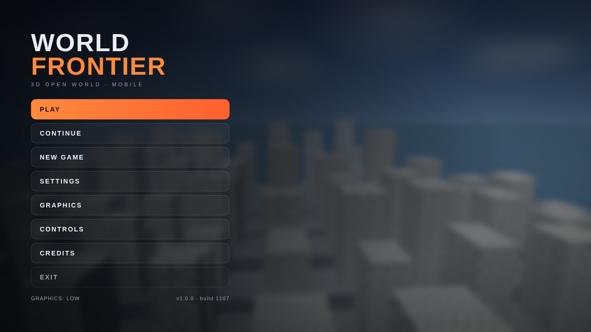

## What is actually implemented

Everything below is running code, not a mockup. The HUD, buttons, missions and
settings all drive the real simulation.

**World** — a continuous 3 km × 3 km+ procedural landscape streamed in 100 m
chunks around the player. Biomes come from a layered value-noise heightmap plus
temperature/moisture fields: ocean, beach, plains, forest, desert, snow and
mountain ridges. A flat city plateau at the origin holds a grid city with ~40 m
blocks, buildings 7–70 m tall, streets, sidewalks and lane markings; two
highways run north–south outside the city; a 6 km water plane with an animated
wave shader covers the sea. Chunks are built and disposed on demand, so there is
no loading screen after the initial generation.

**Character** — a jointed third-person character with procedural walk, run,
sprint, jump, crouch, swim, climb and sit animation, stamina, gravity, and a
spring-damped orbit camera.

**Vehicles** — ten types (sedan, sports car, supercar, motorcycle, scooter, bus,
truck, motorboat, helicopter, light plane) with arcade physics: acceleration,
speed-dependent steering, braking and reverse, slope pitch, body roll, wheel
spin, rotor spin, boat buoyancy, aircraft lift, damage accumulation, engine audio
and enter/exit with a proximity prompt.

**AI** — pedestrians walk waypoint loops and turn to watch the player; traffic
cars follow the road grid, change lanes at intersections and slow near the
player; animals wander in the wild and flee when you approach.

**Environment** — full day/night cycle with a procedural sky shader, sun and
moonlight, stars, drifting cloud sprites, exponential fog matched to the horizon,
and six weather states (clear, cloudy, rain, storm, fog, snow) with pooled
particles and lightning flashes. Building windows glow after dark.

**Gameplay** — 7 missions across 4 types (delivery, checkpoint race, shard
collection, exploration), 28 collectible signal shards, random world events
(supply drops, abandoned vehicles, weather shifts), a world map, a live minimap,
inventory, and a save system with autosave every 30 s.

**Graphics presets** — LOW (default), MEDIUM, HIGH, ULTRA HIGH. Each changes
render scale, shadow map size, view distance, vegetation density, water detail,
particle count, AI budget and LOD distance, and can be switched live without
restarting. The game warns you if your device reports too little RAM/cores for
the preset you picked, and dynamic resolution drops render scale if the frame
rate falls below 24 fps. It never auto-selects ULTRA.

**Audio** — synthesised at runtime with WebAudio (engine note tied to speed,
rain/wind noise bed, thunder, UI clicks, ambient pad). No audio files are
shipped.

## Screenshots

| LOW (default) | HIGH |
|---|---|
| 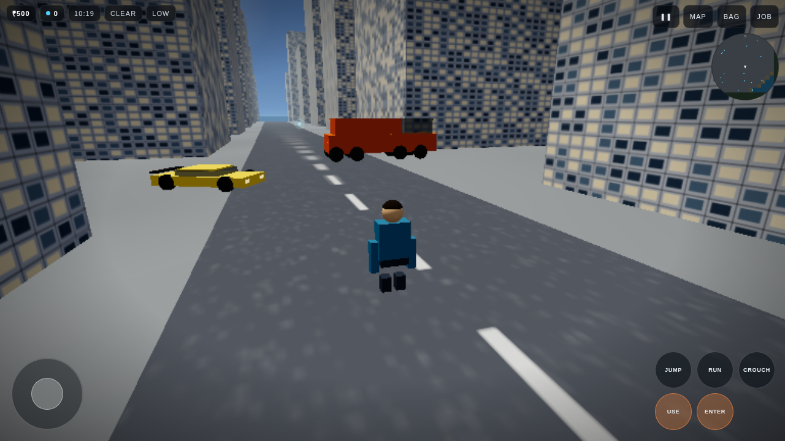 | 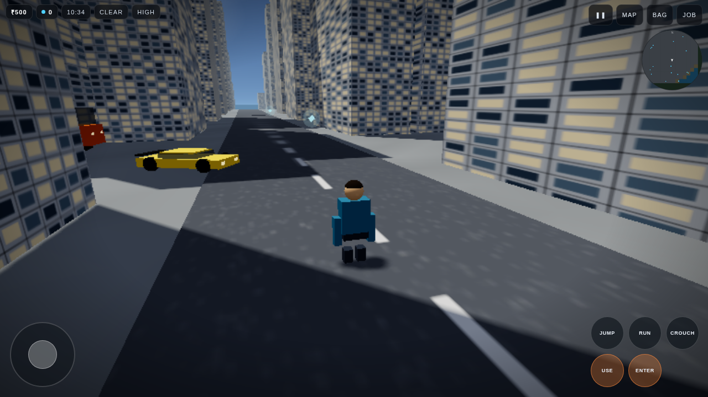 |

| ULTRA HIGH at night | Rain, night city |
|---|---|
| 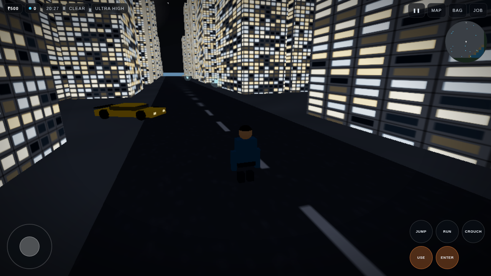 | 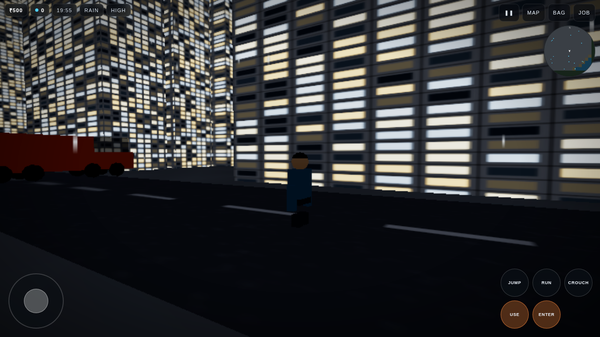 |

| Driving | Coast and forest |
|---|---|
| 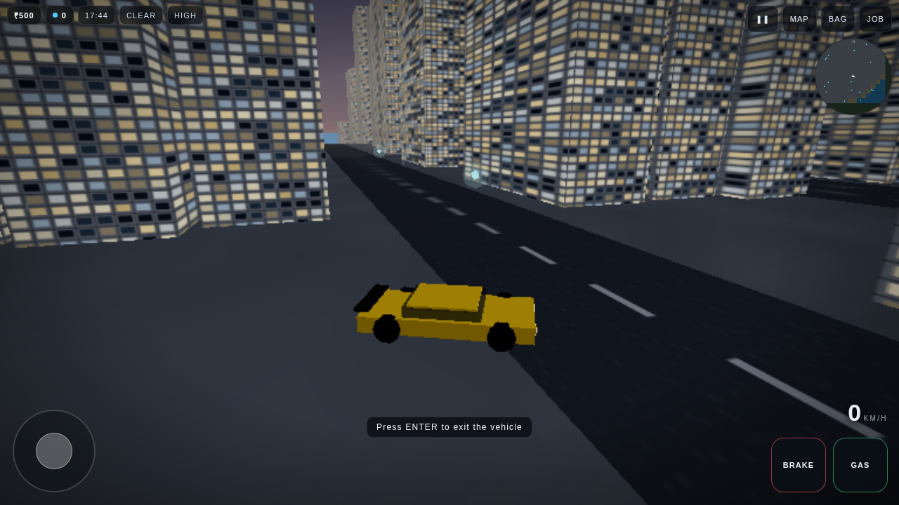 | 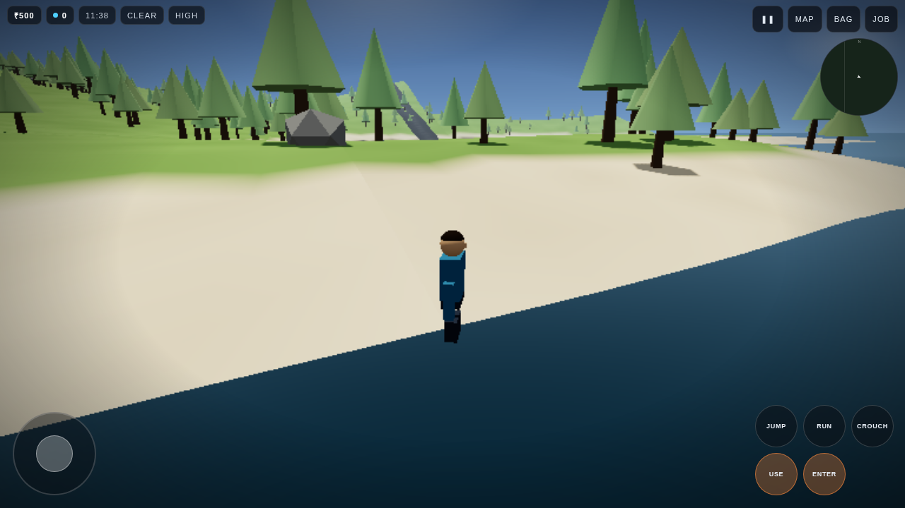 |

| Snow and mountains | World map |
|---|---|
| 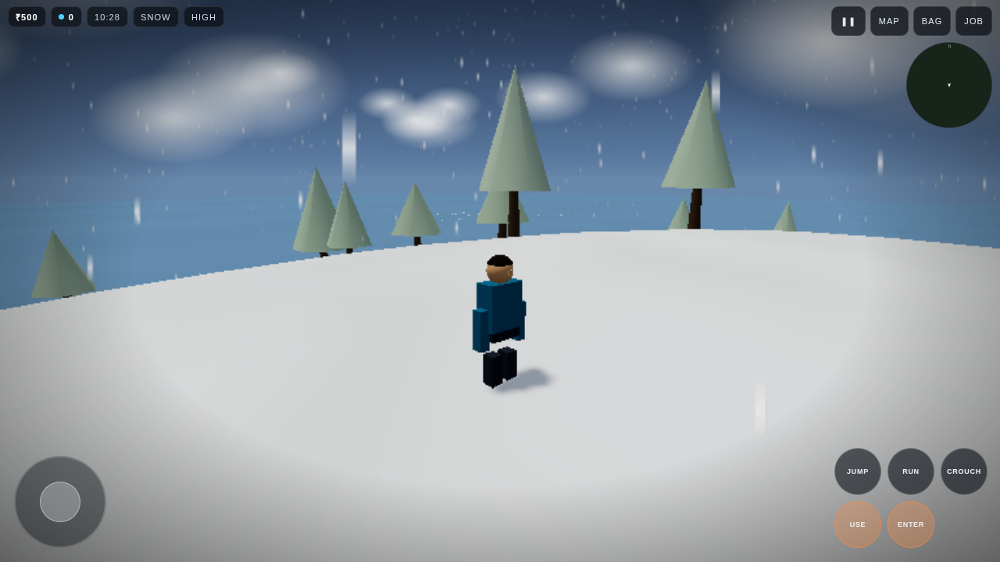 | 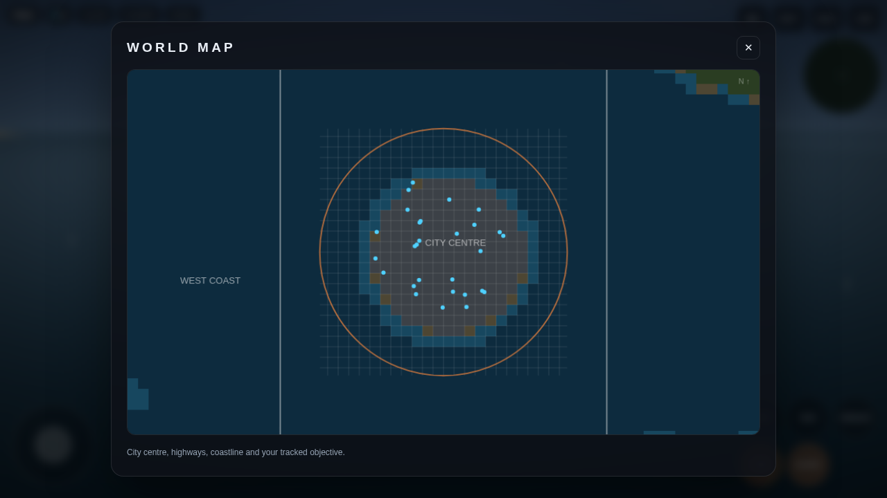 |

| Graphics settings | Credits |
|---|---|
| 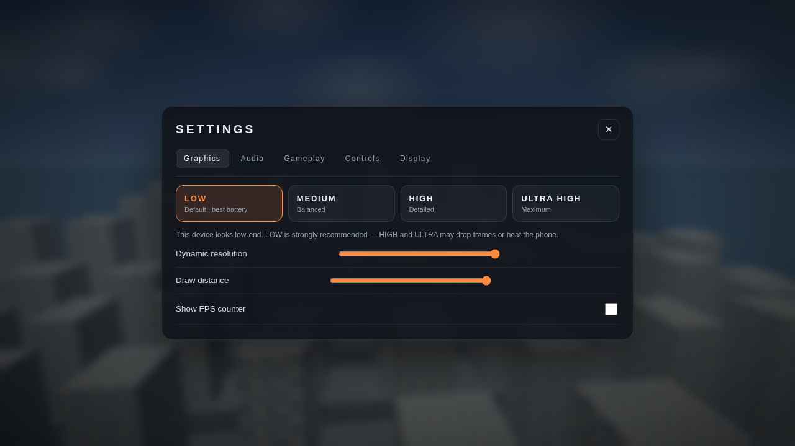 | 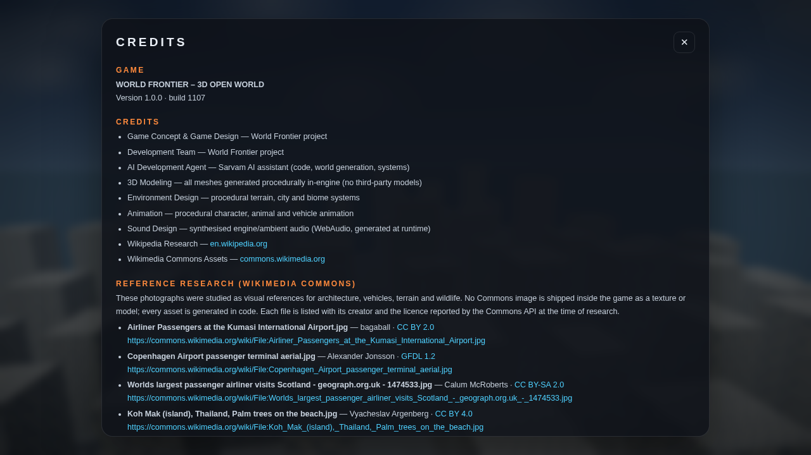 |

## Controls

**On foot** — left stick / WASD to move, drag the right side to look, JUMP
(Space) to jump and climb, RUN (Shift) to sprint, CROUCH (C), USE (E) to
interact, ENTER (F) to enter or exit a vehicle.

**Driving** — left stick or A/D to steer, GAS (W) to accelerate, BRAKE (S) to
brake and reverse, ENTER (F) to get out.

**Interface** — MAP (M), BAG (I), JOB (J), pause (Esc) or the on-screen ❚❚.

## Install the APK

1. Copy `WorldFrontier3D-v1.0.0.apk` to an Android phone (Android 7.0 / API 24 or newer).
2. Allow "install from unknown sources" for your file manager or browser.
3. Install and open. It runs fully offline — the game needs no network permission.

The APK is signed with a debug key, so Play Protect may ask you to confirm the
install. That is expected for a self-signed build.

## Build it yourself

**Web build** (needs Node 20):

```bash
npm install
python3 build.py          # bundles src/ -> dist/game.js
```

Open `dist/index.html` in any WebGL2 browser.

**Android build** (needs JDK 17 + Android SDK build-tools 34):

```bash
bash android/build_apk.sh   # aapt2 -> javac -> d8 -> zipalign -> apksigner
```

The script produces `android/WorldFrontier3D-v1.0.0.apk`. It uses the SDK
command-line tools directly, so no Gradle download is required. The project also
opens in Android Studio (`android/app/src/main`).

## Project layout

```
src/            game source (ES modules)
  util.js       noise, RNG, procedural textures
  settings.js   graphics presets, settings, save system
  world.js      terrain, biomes, city, roads, vegetation, water
  sky.js        sky shader, day/night, weather, precipitation
  entities.js   player, vehicles, pedestrians, animals, traffic
  gameplay.js   camera, missions, collectibles, world events
  ui.js         menus, HUD, touch input, minimap, credits
  main.js       renderer, game loop, state machine, audio
android/        Android host app (WebView + assets)
dist/           built web game
research/       Wikimedia Commons reference metadata (real API data)
test/           headless Chromium smoke, functional and screenshot tests
docs/           screenshots
```

## Honest scope notes

This is a complete, playable game — but it is not a AAA production. The world is
procedurally generated rather than hand-authored, the character and vehicle
meshes are built from primitives in code (no scanned or licensed 3D models),
animation is procedural rather than motion-captured, and there is no voice acting.
Physics are arcade-style. Everything listed above works; nothing is a placeholder
button.

Frame rates quoted in the HUD come from the real render loop. On a mid-range
phone LOW holds 60 fps; ULTRA is for recent flagships.

## Credits and licensing

* Code: MIT (see `LICENSE`).
* Every 3D mesh, texture, icon and sound is generated by the game at runtime —
  no third-party asset is redistributed.
* Real-world reference research used Wikipedia, Wikidata and the Wikimedia
  Commons API. 57 Commons photographs across 19 categories were studied for
  architecture, vehicles, terrain, weather and wildlife. Their creators, licences
  and file pages are listed in [`CREDITS.md`](CREDITS.md) and inside the game
  (Settings → Credits). No Commons image ships as a texture or model.
* Reference material was used for study only. Check each file's licence on its
  Commons page before reusing any image.

> This game is an independent project and is not officially affiliated with
> Wikipedia or the Wikimedia Foundation.

Built with [three.js](https://threejs.org) and the Android SDK.
