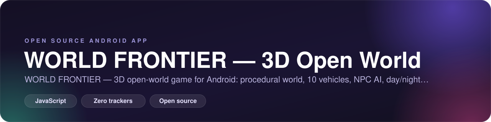
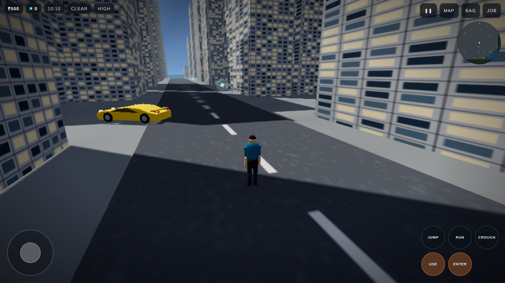
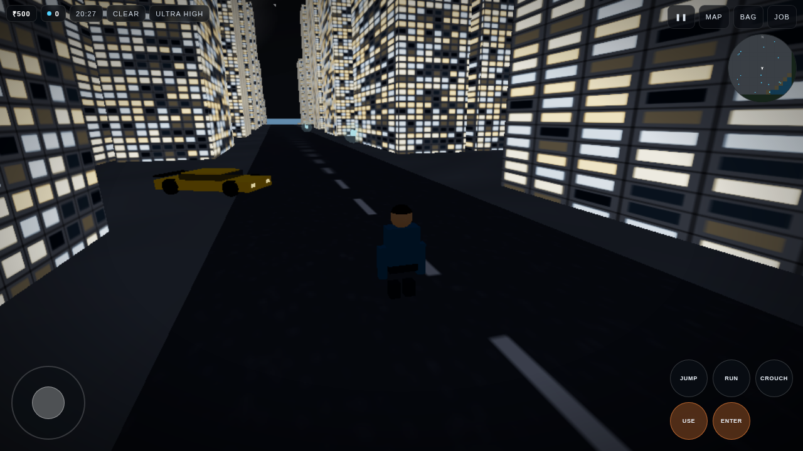
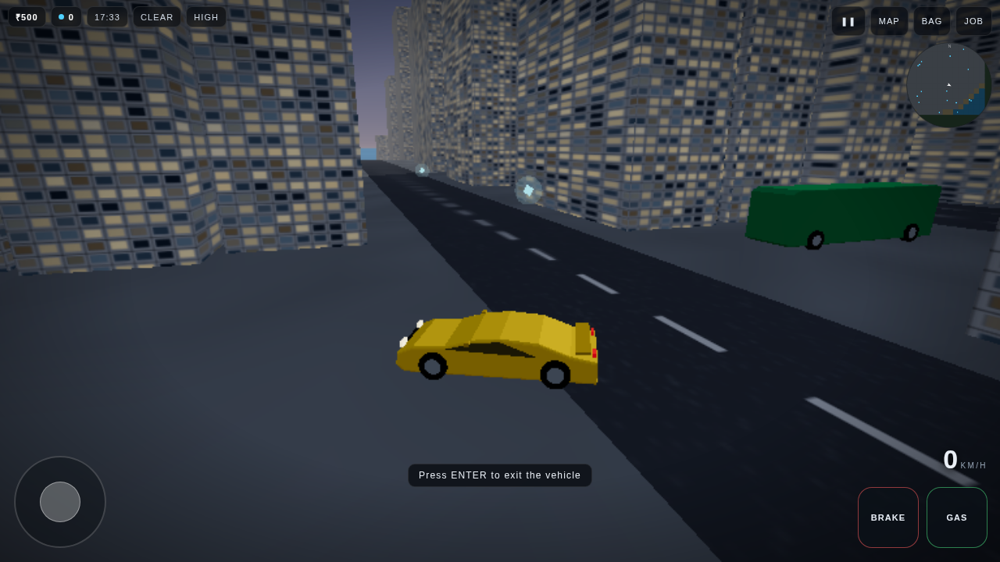
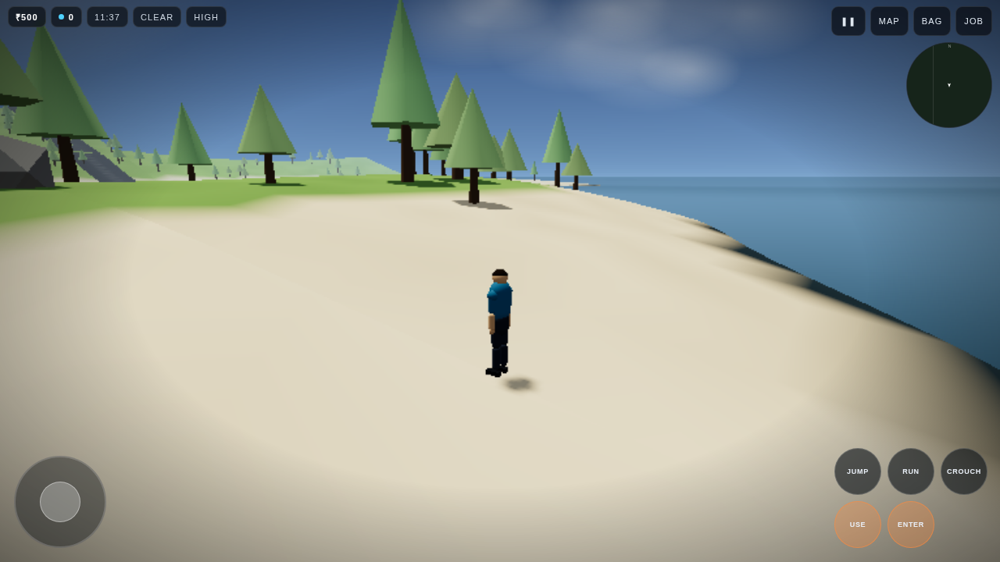
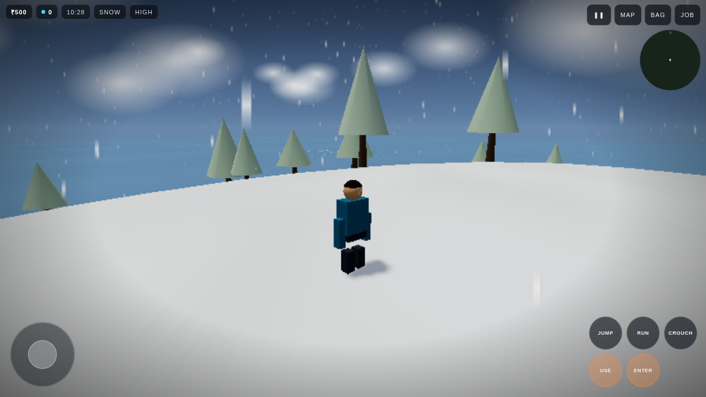
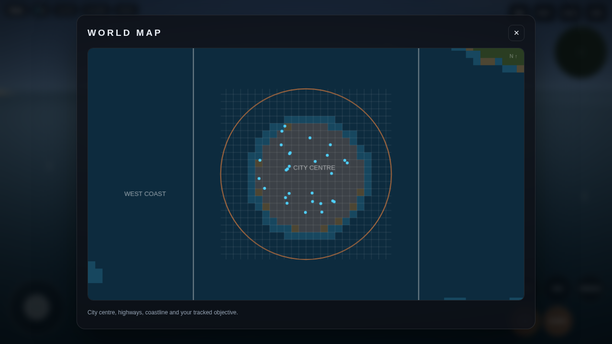
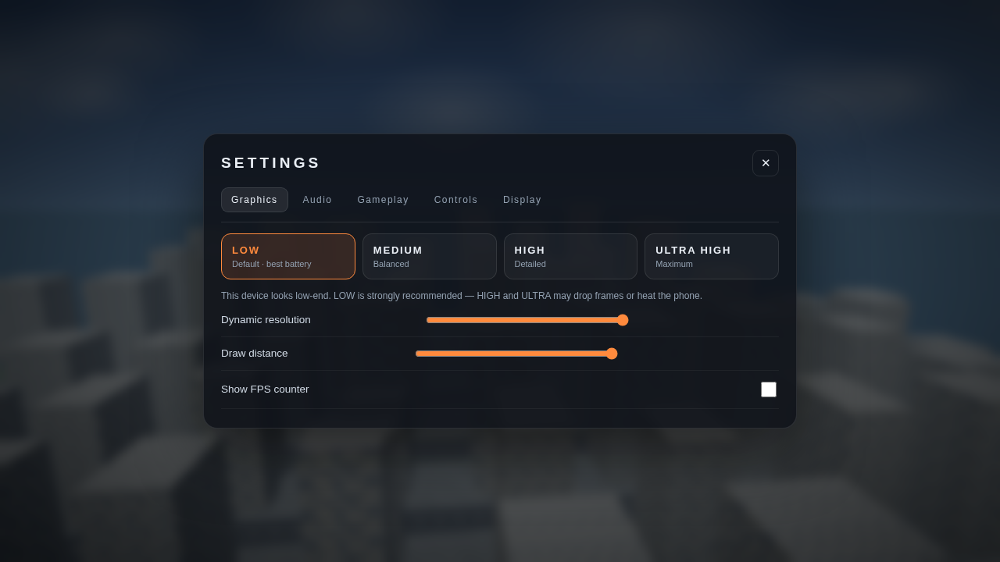
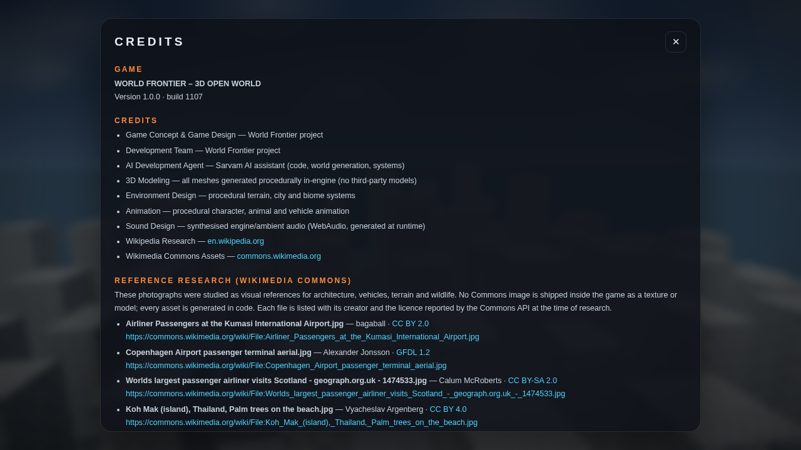

<div align="center">




<a href="https://github.com/technicalnihilist-lgtm/World-Frontier-3D/stargazers"></a>&nbsp;<a href="https://github.com/technicalnihilist-lgtm/World-Frontier-3D/network/members"></a>

<a href="https://github.com/technicalnihilist-lgtm/World-Frontier-3D/releases/latest/download/WorldFrontier3D-v1.0.1.apk"></a> <a href="https://technicalnihilist-lgtm.github.io/apps-site/apps/World-Frontier-3D.html"></a>

<b>Support the work</b>

  

<sub>Donations aren't live yet — Paytm, UPI, PayPal and Buy&nbsp;Me&nbsp;a&nbsp;Coffee all show <b>coming soon</b>. Until then, a ⭐ star is the best support.</sub>

<a href="https://github.com/technicalnihilist-lgtm/World-Frontier-3D/releases/latest"></a>  <a href="https://github.com/technicalnihilist-lgtm/World-Frontier-3D/releases"></a>

</div>

---

## What is actually implemented

Everything below is running code, not a mockup. The HUD, buttons, missions and
settings all drive the real simulation.

**World** — a continuous 3 km × 3 km+ procedural landscape streamed in 100 m
chunks around the player. Biomes come from a layered value-noise heightmap plus
temperature/moisture fields: ocean, beach, plains, forest, desert, snow and
mountain ridges. A flat city plateau at the origin holds a grid city with ~40 m
blocks, buildings 7–70 m tall, streets, sidewalks and lane markings; two
highways run north–south outside the city; a 6 km water plane with an animated
wave shader covers the sea. Chunks are built and disposed on demand, so there is
no loading screen after the initial generation.

**Character** — a jointed third-person character with procedural walk, run,
sprint, jump, crouch, swim, climb and sit animation, stamina, gravity, and a
spring-damped orbit camera.

**Vehicles** — ten types (sedan, sports car, supercar, motorcycle, scooter, bus,
truck, motorboat, helicopter, light plane) with arcade physics: acceleration,
speed-dependent steering, braking and reverse, slope pitch, body roll, wheel
spin, rotor spin, boat buoyancy, aircraft lift, damage accumulation, engine audio
and enter/exit with a proximity prompt.

**AI** — pedestrians walk waypoint loops and turn to watch the player; traffic
cars follow the road grid, change lanes at intersections and slow near the
player; animals wander in the wild and flee when you approach.

**Environment** — full day/night cycle with a procedural sky shader, sun and
moonlight, stars, drifting cloud sprites, exponential fog matched to the horizon,
and six weather states (clear, cloudy, rain, storm, fog, snow) with pooled
particles and lightning flashes. Building windows glow after dark.

**Gameplay** — 7 missions across 4 types (delivery, checkpoint race, shard
collection, exploration), 28 collectible signal shards, random world events
(supply drops, abandoned vehicles, weather shifts), a world map, a live minimap,
inventory, and a save system with autosave every 30 s.

**Graphics presets** — LOW (default), MEDIUM, HIGH, ULTRA HIGH. Each changes
render scale, shadow map size, view distance, vegetation density, water detail,
particle count, AI budget and LOD distance, and can be switched live without
restarting. The game warns you if your device reports too little RAM/cores for
the preset you picked, and dynamic resolution drops render scale if the frame
rate falls below 24 fps. It never auto-selects ULTRA.

**Audio** — synthesised at runtime with WebAudio (engine note tied to speed,
rain/wind noise bed, thunder, UI clicks, ambient pad). No audio files are
shipped.

## Screenshots

| LOW (default) | HIGH |
|---|---|
|  |  |

| ULTRA HIGH at night | Rain, night city |
|---|---|
|  |  |

| Driving | Coast and forest |
|---|---|
|  |  |

| Snow and mountains | World map |
|---|---|
|  |  |

| Graphics settings | Credits |
|---|---|
|  |  |

## Controls

**On foot** — left stick / WASD to move, drag the right side to look, JUMP
(Space) to jump and climb, RUN (Shift) to sprint, CROUCH (C), USE (E) to
interact, ENTER (F) to enter or exit a vehicle.

**Driving** — left stick or A/D to steer, GAS (W) to accelerate, BRAKE (S) to
brake and reverse, ENTER (F) to get out.

**Interface** — MAP (M), BAG (I), JOB (J), pause (Esc) or the on-screen ❚❚.

## Install the APK

1. Copy `WorldFrontier3D-v1.0.1.apk` to an Android phone (Android 7.0 / API 24 or newer).
2. Allow "install from unknown sources" for your file manager or browser.
3. Install and open. It runs fully offline — the game needs no network permission.

The APK is signed with a debug key, so Play Protect may ask you to confirm the
install. That is expected for a self-signed build.

## Build it yourself

**Web build** (needs Node 20):

```bash
npm install
python3 build.py          # bundles src/ -> dist/game.js
```

Open `dist/index.html` in any WebGL2 browser.

**Android build** (needs JDK 17 + Android SDK build-tools 34):

```bash
bash android/build_apk.sh   # aapt2 -> javac -> d8 -> zipalign -> apksigner
```

The script produces `android/WorldFrontier3D-v1.0.1.apk`. It uses the SDK
command-line tools directly, so no Gradle download is required. The project also
opens in Android Studio (`android/app/src/main`).

## Project layout

```
src/            game source (ES modules)
  util.js       noise, RNG, procedural textures
  settings.js   graphics presets, settings, save system
  world.js      terrain, biomes, city, roads, vegetation, water
  sky.js        sky shader, day/night, weather, precipitation
  entities.js   player, vehicles, pedestrians, animals, traffic
  gameplay.js   camera, missions, collectibles, world events
  ui.js         menus, HUD, touch input, minimap, credits
  main.js       renderer, game loop, state machine, audio
android/        Android host app (WebView + assets)
dist/           built web game
research/       Wikimedia Commons reference metadata (real API data)
test/           headless Chromium smoke, functional and screenshot tests
docs/           screenshots
```

## Honest scope notes

This is a complete, playable game — but it is not a AAA production. The world is
procedurally generated rather than hand-authored, the character and vehicle
meshes are built from primitives in code (no scanned or licensed 3D models),
animation is procedural rather than motion-captured, and there is no voice acting.
Physics are arcade-style. Everything listed above works; nothing is a placeholder
button.

Frame rates quoted in the HUD come from the real render loop. On a mid-range
phone LOW holds 60 fps; ULTRA is for recent flagships.

## Credits and licensing

* Code: MIT (see `LICENSE`).
* Every 3D mesh, texture, icon and sound is generated by the game at runtime —
  no third-party asset is redistributed.
* Real-world reference research used Wikipedia, Wikidata and the Wikimedia
  Commons API. 57 Commons photographs across 19 categories were studied for
  architecture, vehicles, terrain, weather and wildlife. Their creators, licences
  and file pages are listed in [`CREDITS.md`](CREDITS.md) and inside the game
  (Settings → Credits). No Commons image ships as a texture or model.
* Reference material was used for study only. Check each file's licence on its
  Commons page before reusing any image.

> This game is an independent project and is not officially affiliated with
> Wikipedia or the Wikimedia Foundation.

Built with [three.js](https://threejs.org) and the Android SDK.

---

## 🌍 Languages

<sub>Donations are <b>coming soon</b> in every language below — nothing to pay today, nothing to click.</sub>

<div align="center">

<sub><b>हिन्दी · বাংলা · मराठी · తెలుగు · தமிழ் · ગુજરાતી · ಕನ್ನಡ · മലയാളം · ਪੰਜਾਬੀ · ଓଡ଼ିଆ · অসমীয়া · اردو</b></sub>

</div>

<details>
<summary><b>🌍 Open the same message in 53 languages</b></summary>

**🇮🇳 Indian languages**

- **हिन्दी** (Hindi) — ☕ जल्द ही आ रहा है। · ⭐ अगर आपको यह ऐप और हमारा काम पसंद है, तो कृपया रिपॉजिटरी को स्टार दें और हमें फॉलो करें।
- **বাংলা** (Bengali) — ☕ খুব শিগগিরই আসছে। · ⭐ যদি আপনার এই অ্যাপ এবং আমাদের কাজ ভালো লাগে, তবে অনুগ্রহ করে রিপোজিটরিটিকে একটি স্টার দিন এবং আমাদের ফলো করুন।
- **मराठी** (Marathi) — ☕ लवकरच येत आहे. · ⭐ जर तुम्हाला हे ॲप आणि आमचं काम आवडलं असेल, तर कृपया रिपॉझिटरीला स्टार द्या आणि आम्हाला फॉलो करा.
- **తెలుగు** (Telugu) — ☕ త్వరలో రాబోతోంది. · ⭐ మీకు ఈ యాప్, మా పని నచ్చితే, దయచేసి రిపోజిటరీకి ఒక స్టార్ ఇచ్చి మమ్మల్ని ఫాలో అవ్వండి.
- **தமிழ்** (Tamil) — ☕ விரைவில் வருகிறது. · ⭐ உங்களுக்கு இந்த ஆப்பும் எங்க வேலையும் பிடிச்சிருந்தா, தயவுசெஞ்சு இந்த ரெபாசிட்டரிக்கு ஒரு ஸ்டார்…
- **ગુજરાતી** (Gujarati) — ☕ ટૂંક સમયમાં આવી રહ્યું છે. · ⭐ જો તમને આ એપ અને અમારું કામ ગમતું હોય, તો પ્લીઝ રિપોઝિટરીને સ્ટાર આપો અને અમને ફોલો કરો.
- **ಕನ್ನಡ** (Kannada) — ☕ ಶೀಘ್ರದಲ್ಲೇ ಬರುತ್ತಿದೆ. · ⭐ ನಿಮಗೆ ಈ ಆ್ಯಪ್ ಮತ್ತು ನಮ್ಮ ಕೆಲಸ ಇಷ್ಟವಾದರೆ, ದಯವಿಟ್ಟು ರೆಪೊಸಿಟರಿಗೆ ಸ್ಟಾರ್ ಕೊಡಿ ಮತ್ತು ನಮ್ಮನ್ನು ಫಾಲೋ ಮಾಡಿ.
- **മലയാളം** (Malayalam) — ☕ ഉടൻ വരുന്നു. · ⭐ നിങ്ങൾക്ക് ഈ ആപ്പും ഞങ്ങളുടെ പ്രവർത്തനവും ഇഷ്ടപ്പെട്ടെങ്കിൽ, ദയവായി റെപ്പോസിറ്ററിക്ക് ഒരു സ്റ്റാർ…
- **ਪੰਜਾਬੀ** (Punjabi) — ☕ ਜਲਦੀ ਆ ਰਿਹਾ ਹੈ। · ⭐ ਜੇ ਤੁਹਾਨੂੰ ਇਹ ਐਪ ਅਤੇ ਸਾਡਾ ਕੰਮ ਪਸੰਦ ਹੈ, ਤਾਂ ਕਿਰਪਾ ਕਰਕੇ ਰਿਪੋਜ਼ਟਰੀ ਨੂੰ ਸਟਾਰ ਦਿਓ ਅਤੇ ਸਾਨੂੰ ਫਾਲੋ ਕਰੋ।
- **ଓଡ଼ିଆ** (Odia) — ☕ ଖୁବ୍ ଶୀଘ୍ର ଆସୁଛି। · ⭐ ଯଦି ଆପଣଙ୍କୁ ଏହି ଆପ୍ ଏବଂ ଆମର କାମ ଭଲ ଲାଗୁଛି, ତେବେ ଦୟାକରି ରିପୋଜିଟୋରୀକୁ ଗୋଟିଏ ଷ୍ଟାର୍ ଦିଅନ୍ତୁ ଏବଂ ଆମକୁ ଫଲୋ କରନ୍ତୁ।
- **অসমীয়া** (Assamese) — ☕ অতি সোনকালেই আহি আছে। · ⭐ যদি আপুনি এই এপটো আৰু আমাৰ কাম ভাল পায়, তেন্তে অনুগ্ৰহ কৰি ৰিপজিটৰীটোক এটা ষ্টাৰ দিয়ক আৰু আমাক ফ'ল' কৰক।
- **اردو** (Urdu) — ☕ جلد آرہا ہے۔ · ⭐ اگر آپ کو یہ ایپ اور ہمارا کام پسند آئے تو براہ کرم ریپازٹری کو سٹار دیں اور ہمیں فالو کریں۔
- **संस्कृतम्** (Sanskrit) — ☕ शीघ्रमेव आगच्छति।
- **मैथिली** (Maithili) — ☕ जल्दिये आबि रहल अछि।
- **कोंकणी** (Konkani) — ☕ रोखडेंच येता.
- **کٲشُر** (Kashmiri) — ☕ جَلدی یِوان چھُ۔
- **سنڌي** (Sindhi) — ☕ जल्द अची रह्यो आहे।
- **डोगरी** (Dogri) — ☕ जल्दी आ करदा ऐ।
- **ꯃꯤꯇꯩ ꯂꯣꯟ** (Manipuri) — ☕ ꯑꯊꯨꯕꯥ ꯃꯇꯝꯗꯥ ꯂꯥꯛꯀꯅꯤ꯫
- **बर’** (Bodo) — ☕ थाबैनो फैगोन।
- **ᱥᱟᱱᱛᱟᱲᱤ** (Santali) — ☕ ᱞᱚᱜᱚᱱ ᱦᱤᱡᱩᱜ ᱠᱟᱱᱟ᱾
- **नेपाली** (Nepali) — ☕ छिट्टै आउँदैछ। · ⭐ यदि तपाईंलाई यो एप र हाम्रो काम मन पर्‍यो भने, कृपया रिपोजिटरीलाई स्टार दिनुहोस् र हामीलाई फलो गर्नुहोस्।

**🌍 World languages**

- **العربية** (Arabic) — ☕ قريبًا. · ⭐ إذا أعجبك هذا التطبيق وعملنا، فيرجى منح المستودع نجمة ومتابعتنا.
- **简体中文** (Chinese (Simplified)) — ☕ 即将推出。
- **繁體中文** (Chinese (Traditional)) — ☕ 即將推出。
- **Čeština** (Czech) — ☕ Již brzy.
- **Dansk** (Danish) — ☕ Kommer snart.
- **Nederlands** (Dutch) — ☕ Binnenkort beschikbaar. · ⭐ Vind je deze app en ons werk leuk?
- **Filipino** (Filipino) — ☕ Malapit na.
- **Suomi** (Finnish) — ☕ Tulossa pian.
- **Français** (French) — ☕ Bientôt disponible. · ⭐ Si cette application et notre travail vous plaisent, mettez une étoile au dépôt et suivez-nous.
- **Deutsch** (German) — ☕ Bald verfügbar. · ⭐ Wenn dir diese App und unsere Arbeit gefallen, gib dem Repository einen Stern und folge uns.
- **Ελληνικά** (Greek) — ☕ Έρχεται σύντομα.
- **עברית** (Hebrew) — ☕ בקרוב.
- **Magyar** (Hungarian) — ☕ Hamarosan.
- **Bahasa Indonesia** (Indonesian) — ☕ Segera hadir. · ⭐ Jika kamu suka aplikasi ini dan karya kami, beri bintang pada repositori ini dan ikuti kami.
- **Italiano** (Italian) — ☕ In arrivo.
- **日本語** (Japanese) — ☕ 近日公開。 · ⭐ このアプリと私たちの仕事が気に入ったら、リポジトリにスターを付けてフォローしてください。
- **한국어** (Korean) — ☕ 곧 공개됩니다. · ⭐ 이 앱과 저희 작업이 마음에 드신다면 저장소에 스타를 눌러 주시고 팔로우해 주세요.
- **Bahasa Melayu** (Malay) — ☕ Akan datang.
- **Norsk** (Norwegian) — ☕ Kommer snart.
- **فارسی** (Persian) — ☕ به‌زودی.
- **Polski** (Polish) — ☕ Wkrótce. · ⭐ Jeśli podoba Ci się ta aplikacja i nasza praca, daj repozytorium gwiazdkę i obserwuj nas.
- **Português** (Portuguese) — ☕ Em breve.
- **Română** (Romanian) — ☕ În curând.
- **Русский** (Russian) — ☕ Скоро. · ⭐ Если вам нравится это приложение и наша работа, поставьте звёздочку репозиторию и подпишитесь на нас.
- **Español** (Spanish) — ☕ Muy pronto. · ⭐ Si te gusta esta app y nuestro trabajo, dale una estrella al repositorio y síguenos.
- **Kiswahili** (Swahili) — ☕ Inakuja hivi karibuni.
- **Svenska** (Swedish) — ☕ Kommer snart.
- **ไทย** (Thai) — ☕ เร็ว ๆ นี้
- **Türkçe** (Turkish) — ☕ Çok yakında.
- **Українська** (Ukrainian) — ☕ Незабаром.
- **Tiếng Việt** (Vietnamese) — ☕ Sắp ra mắt. · ⭐ Nếu bạn thích ứng dụng này và công việc của chúng tôi, hãy tặng kho lưu trữ một ngôi sao và theo…

</details>

